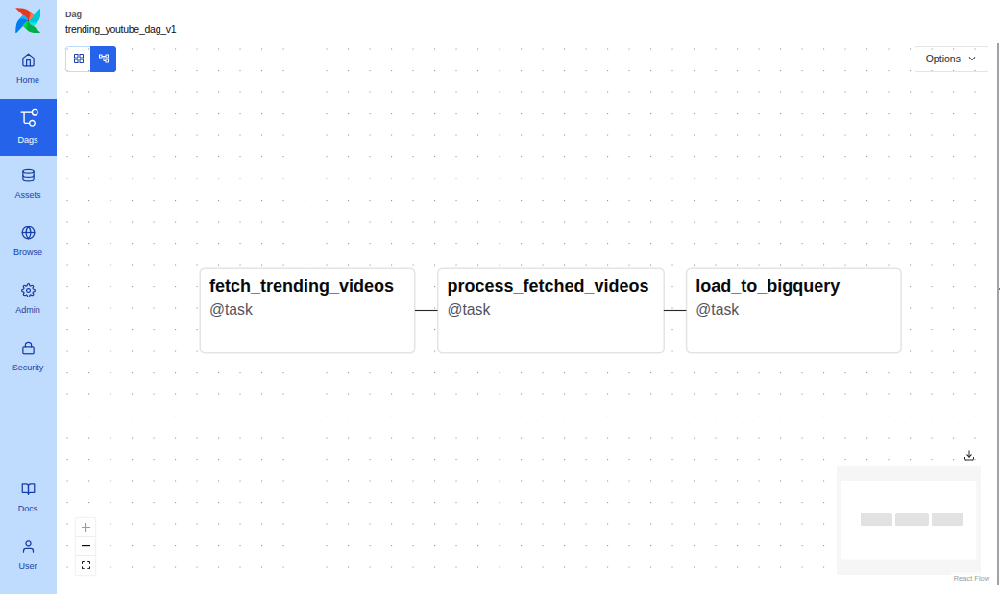
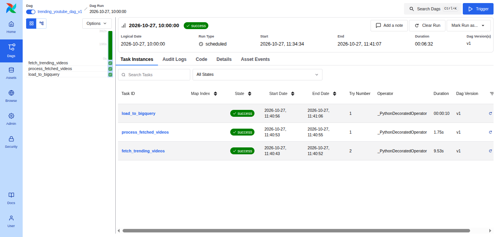
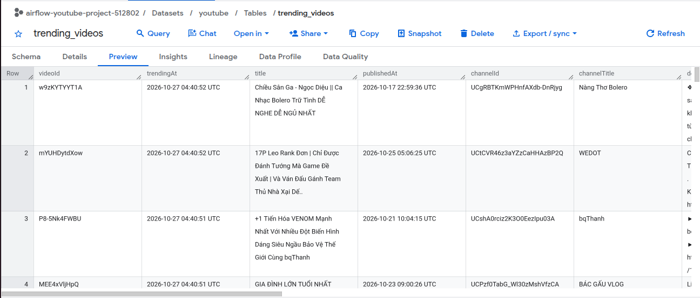

# Implementation

## Setting up the environment

First, create project root directory: `mkdir airflow_youtube_project`

Then, follow the steps in the [Running Airflow in Docker](intro_to_airflow.md#running-airflow-in-docker).

Next we will create a new virtual environment and install the required packages in the virtual environment (via [uv](https://docs.astral.sh/uv/)).

```python
cd airflow_youtube_project
uv init
uv add apache-airflow google-api-python-client python-dotenv isodate google-cloud-bigquery
```

Now we need to create a new project in Google Cloud Platform. First go to the [Google Cloud Console](https://console.cloud.google.com/), then click on the project dropdown menu and select `New Project`. We will name the project as `airflow-youtube-project` and click `Create`. Wait a few moment until the project is sucessfully created. Note that the project ID may be different from the project name.

Once the project is created, select the project from the dropdown menu and go to the [APIs & Services Dashboard](https://console.cloud.google.com/apis/dashboard). Click on `Enable APIs and Services`, then search for `Youtube Data API v3` and enable them. By default, the BigQuery API should already be enabled (in case it is not, please enable it as well). After enabling the `Youtube Data API v3`, click on the `Credentials` tab. Click on the `Create Credentials` and select `API key`. Copy the API key and save it in a `.env` file in the `airflow_youtube_project/dags` directory. We will use this API key later to fetch data from YouTube.

The content of the `.env` file should be similar to this.

```
YOUTUBE_API_KEY=your_youtube_api_key
```

Next we will create a new service account and download the service account key. Go to the [Service Accounts](https://console.cloud.google.com/iam-admin/serviceaccounts) page and click on `Create Service Account`. Give your service account a name and click `Create and Continue`. Select `BigQuery Admin` as the role, then click `Done`. Click on `Action` and select `Manage keys`. Click `Add key` and select `Create new key`. Select `JSON` as the key type and click `Create`. Save the downloaded JSON file in the `airflow_youtube_project/dags` directory. Let's rename the json file to `service_account_key.json` for simplicity. We will use this JSON file to authenticate our BigQuery client.

Note that we are saving the `.env` and JSON files in the `airflow_youtube_project/dags` directory. This is done so the Docker containers are able access those files as well. In the `docker-compose.yaml` file, the volume sharing is specified using the volumes parameter, which maps the local directories to the directories inside the container. E.g. the files inside the `airflow_youtube_project/dags` directory will be shared with the `/opt/airflow/dags` directory inside the container.

```yml
volumes:
  - ${AIRFLOW_PROJ_DIR:-.}/dags:/opt/airflow/dags
  - ${AIRFLOW_PROJ_DIR:-.}/logs:/opt/airflow/logs
  - ${AIRFLOW_PROJ_DIR:-.}/config:/opt/airflow/config
  - ${AIRFLOW_PROJ_DIR:-.}/plugins:/opt/airflow/plugins
```

Now let's create a new BigQuery dataset using [this Python script](../create_bq_dataset.py). This will also let us test if the service account key is working properly.

```python
from google.cloud import bigquery
from google.oauth2 import service_account

key_path = 'dags/service_account_key.json'
credentials = service_account.Credentials.from_service_account_file(
    key_path,
    scopes=["https://www.googleapis.com/auth/cloud-platform"],
)
client = bigquery.Client(credentials=credentials)

dataset_id = 'youtube'
dataset = bigquery.Dataset(f"{client.project}.{dataset_id}")
dataset = client.create_dataset(dataset)
```

To confirm that the dataset has been created, we can run the following python code.

```python
datasets = client.list_datasets()
for dataset in datasets:
    print(dataset.dataset_id)
```

You should see `youtube` in the output if the dataset has been created successfully.

## Fetching and Processing Data from YouTube Data API

Below is a sample code to fetch the first 50 results of the trending YouTube videos in Vietnam. If you wish to read more about the parameters of the API request, you can refer to [this documentation page](https://developers.google.com/youtube/data/reference/rest/v3/videos/list). And if you wish to read more about the details of the items returned in the response, you can refer to [this documentation page](https://developers.google.com/youtube/data/reference/rest/v3/videos#resource).

```python
import os
from dotenv import load_dotenv
from googleapiclient.discovery import build

load_dotenv("dags/.env")
api_key = os.environ.get("YOUTUBE_API_KEY")
youtube = build("youtube", "v3", developerKey=api_key)

request = youtube.videos().list(
    part="snippet,contentDetails,statistics",
    chart="mostPopular",
    regionCode="vn",
    maxResults=50,
)
response = request.execute()
```

Now we will make a function to fetch a list of trending videos from the YouTube Data API. The function takes the region code, maximum number of results, and the path to the target file as the arguments. The function will extract the relevant information from the API response and save it in a list of dictionaries, which will then be written to a JSON file.

```python
from dotenv import load_dotenv
import os
from googleapiclient.discovery import build
import json
from datetime import datetime

def fetch_trending_videos(region_code: str, max_results: int, target_file_path: str):

    load_dotenv("dags/.env")
    api_key = os.environ.get("YOUTUBE_API_KEY")

    youtube = build("youtube", "v3", developerKey=api_key)

    videos_list = []
    next_page_token = ""
    while len(videos_list) < max_results and next_page_token is not None:
        request = youtube.videos().list(
            part="snippet,contentDetails,statistics",
            chart="mostPopular",
            regionCode=region_code,
            maxResults=50,
            pageToken=next_page_token,
        )
        response = request.execute()

        videos = response.get("items", [])

        next_page_token = response.get("nextPageToken", None)
        
        infos = {'snippet':['title', 'publishedAt', 'channelId', 'channelTitle',
                            'description', 'tags', 'thumbnails', 'categoryId', 'defaultAudioLanguage'],
                    'contentDetails':['duration', 'caption'],
                    'statistics':['viewCount', 'likeCount', 'commentCount']}
        now = datetime.utcnow().strftime('%Y-%m-%dT%H:%M:%SZ')
        for video in videos:
            video_details = {
                'videoId': video["id"],
                'trendingAt': now
            }
            
            for k in infos.keys():
                for info in infos[k]:
                    try:
                        video_details[info] = video[k][info]
                    except KeyError:
                        video_details[info] = None
                        
            videos_list.append(video_details)

    with open(target_file_path, "w") as f:
        json.dump(videos_list, f)
```

If we run the function below.

```python
fetch_trending_videos("VN", 200, "tmp_file.json")
```

We should see a JSON file named `tmp_file.json` in the current directory.

```json
[
  {
    "videoId": "_UYa_kYIQxs",
    "trendingAt": "2026-10-27T04:40:51Z",
    "title": "\u0110en x Lynk Lee x Pink Frog - Nh\u1eefng em b\u00e9 M\u1eb7t Tr\u1eddi (M/V)",
    "publishedAt": "2026-10-22T13:00:06Z",
    "channelId": "UCWu91J5KWEj1bQhCBuGeJxw",
    "channelTitle": "\u0110en V\u00e2u Official",
    "description": ...,
    "tags": [
      "den",
      "den vau",
      "\u0111en",
      "\u0111en v\u00e2u",
      "rap hip hop",
      "rapper \u0111en"
    ],
    "thumbnails": {
      "default": {
        "url": "https://i.ytimg.com/vi/_UYa_kYIQxs/default.jpg",
        "width": 120,
        "height": 90
      },
      "medium": {
        ...
      },
      "high": {
        ...
      },
      "standard": {
        ...
      },
      "maxres": {
        ...
      },
      "uhd": {
        ...
      }
    },
    "categoryId": "10",
    "defaultAudioLanguage": "vi",
    "duration": "PT5M51S",
    "caption": "true",
    "viewCount": "1399341",
    "likeCount": "41654",
    "commentCount": "2249"
  },
  ...
]
```

From the result above, we can see that some of the data need further processing. First we will focus on the `categoryId`, which is a numeric value. We will need to convert it to the corresponding category name. We can find the category mapping by performing a YouTube API request as follows. We will also save the category mapping to a JSON file for later use. The entire logic in [this script](../scripts/fetch_categories.py).

The content of `categories.json` should look like this.

```json
{
  "1": "Film & Animation",
  "2": "Autos & Vehicles",
  "10": "Music",
  ...
}
```

Next, we will make a function to process the json data obtained from `fetch_trending_videos` function. The function will do the following things:
- Convert the `duration` from ISO 8601 standard to seconds
- Convert the `tags` list to string
- Map the `categoryId` to the corresponding category name
- Parse the thumbnail URL from `thumbnails`
- Convert `viewCount`, `likeCount`, and `commentCount` to integer; and `caption` to boolean
- Save the processed data to a new json file

```python
import json
import isodate

def process_fetched_data(source_file_path: str, target_file_path: str):

    with open(source_file_path, 'r') as f:
        videos_list = json.load(f)
    
    with open('dags/categories.json', 'r') as f:
        categories = json.load(f)
    
    for video in videos_list:
        video['durationSec'] = int(isodate.parse_duration(video['duration']).total_seconds()) if video['duration'] is not None else None
        del video['duration']
        
        video['tags'] = ', '.join(video['tags']) if video['tags'] is not None else None
        
        video['category'] = categories.get(video['categoryId'], None) if video['categoryId'] is not None else None
        del video['categoryId']

        video['thumbnailUrl'] = video['thumbnails'].get('standard', {}).get('url', None) if video['thumbnails'] is not None else None
        del video['thumbnails']

        video['viewCount'] = int(video['viewCount']) if video['viewCount'] is not None else None
        video['likeCount'] = int(video['likeCount']) if video['likeCount'] is not None else None
        video['commentCount'] = int(video['commentCount']) if video['commentCount'] is not None else None
        
        video['caption'] = True if video['caption'] == 'true' else False if video['caption'] == 'false' else None
    
    with open(target_file_path, "w") as f:
        json.dump(videos_list, f)
```

Now let's try to run the `process_fetched_data` function to process the json file (`tmp_file.json`) we generated earlier. We will save the processed data to a new file called `tmp_file_processed.json`.

```python
process_fetched_data('tmp_file.json', 'tmp_file_processed.json')
```

Below is the snippet of `tmp_file_processed.json` content. Notice the difference in the `tags`, `durationSec` (formerly `duration`), `category` (formerly `categoryId`) and `thumbnailUrl` (formerly `thumbnails`). The data type for `viewCount`, `likeCount`, `commentCount`, and `caption` have also been converted appropriately.

```json
[
  {
    "videoId": "_UYa_kYIQxs",
    "trendingAt": "2026-10-27T04:40:51Z",
    "title": "\u0110en x Lynk Lee x Pink Frog - Nh\u1eefng em b\u00e9 M\u1eb7t Tr\u1eddi (M/V)",
    "publishedAt": "2026-10-22T13:00:06Z",
    "channelId": "UCWu91J5KWEj1bQhCBuGeJxw",
    "channelTitle": "\u0110en V\u00e2u Official",
    "description": ...,
    "tags": "den, den vau, \u0111en, \u0111en v\u00e2u, rap hip hop, rapper \u0111en",
    "defaultAudioLanguage": "vi",
    "caption": true,
    "viewCount": 1399341,
    "likeCount": 41654,
    "commentCount": 2249,
    "durationSec": 351,
    "category": "Music",
    "thumbnailUrl": "https://i.ytimg.com/vi/_UYa_kYIQxs/sddefault.jpg"
  },
  ...
]
```

## Loading Data to BigQuery

Now we will create two new tables called `trending_videos` and `trending_videos_test` in the `youtube` dataset. The `trending_videos` table will be used to store the processed data generated by the Airflow pipeline, while the `trending_videos_test` table will be used for testing purposes.

```python
from google.oauth2 import service_account
from google.cloud import bigquery

key_path = 'dags/service_account_key.json'

credentials = service_account.Credentials.from_service_account_file(
    key_path,
    scopes=["https://www.googleapis.com/auth/cloud-platform"],
)

client = bigquery.Client(credentials=credentials)

schema = [
    bigquery.SchemaField('videoId', 'STRING'),
    bigquery.SchemaField('trendingAt', 'TIMESTAMP'),
    bigquery.SchemaField('title', 'STRING'),
    bigquery.SchemaField('publishedAt', 'TIMESTAMP'),
    bigquery.SchemaField('channelId', 'STRING'),
    bigquery.SchemaField('channelTitle', 'STRING'),
    bigquery.SchemaField('description', 'STRING'),
    bigquery.SchemaField('tags', 'STRING'),
    bigquery.SchemaField('category', 'STRING'),
    bigquery.SchemaField('defaultAudioLanguage', 'STRING'),
    bigquery.SchemaField('durationSec', 'INTEGER'),
    bigquery.SchemaField('caption', 'BOOLEAN'),
    bigquery.SchemaField('viewCount', 'INTEGER'),
    bigquery.SchemaField('likeCount', 'INTEGER'),
    bigquery.SchemaField('commentCount', 'INTEGER'),
    bigquery.SchemaField('thumbnailUrl', 'STRING')
]

dataset_ref = client.dataset('youtube')
table1_ref = dataset_ref.table('trending_videos')
table2_ref = dataset_ref.table('trending_videos_test')

table1 = bigquery.Table(table1_ref, schema=schema)
table2 = bigquery.Table(table2_ref, schema=schema)

client.create_table(table1)
client.create_table(table2)
```

To confirm that the table has been created, we can run the following code to list all the tables in the `youtube` dataset.

```python
tables = client.list_tables('youtube')
for table in tables:
    print(table.table_id)
```

You should see `trending_videos` and `trending_videos_test` in the output if the table has been created successfully.

Once the table has been created, we will be able to load the data from our json file to the table. We will make a function called `load_to_bigquery` to do this.

```python
from google.oauth2 import service_account
from google.cloud import bigquery
import json

def load_to_bigquery(source_file_path: str, table_name: str):

    key_path = 'dags/service_account_key.json'

    credentials = service_account.Credentials.from_service_account_file(
        key_path,
        scopes=["https://www.googleapis.com/auth/cloud-platform"],
    )

    client = bigquery.Client(credentials=credentials)
    
    dataset_ref = client.dataset('youtube')
    table_ref = dataset_ref.table(table_name)
    table = client.get_table(table_ref)
    
    with open(source_file_path, 'r') as f:
        json_data = json.load(f)
    job_config = bigquery.LoadJobConfig()
    job_config.source_format = bigquery.SourceFormat.NEWLINE_DELIMITED_JSON
    job = client.load_table_from_json(json_data, table, job_config = job_config)
    job.result()
    
    print(f"Loaded {job.output_rows} rows to {table.table_id}")
```

Now let's load the data to BigQuery by running the following code.

```python
load_to_bigquery('tmp_file_processed.json', 'trending_videos_test')
```

You should see something like `Loaded 200 rows to airflow-youtube-project-{...}.youtube.trending_videos_test` in the output if everything is running properly.

## Building the Airflow DAG

The code for full Airflow DAG: [trending_youtube_dag.py](../dags/trending_youtube_dag.py)

Let's explore some specific sections of the code 

The code below defines the default configuration options for an Airflow DAG. It specifies various attributes that apply to all tasks within the DAG unless overridden at the task level. With the configuration below, a failed task will be retried for 3 times with 5 minutes delay between each retry.

```python
default_args = {
    'owner': 'tmtsmrsl',
    'retries': 3,
    'retry_delay': timedelta(minutes=5)
}
```

The next section of the code defines the DAG itself. Below are the explanations of the parameters included in the `@dag` decorator:
- `dag_id` parameter is a unique identifier for the DAG, which will be shown in the Airflow Webserver UI
- `default_args` parameter refers to the configuration options defined above
- `description` parameter provides a description or summary of the DAG's purpose
- `start_date` parameter is the date when the DAG is eligible to run tasks, which you can adjust to the current date
- `schedule` parameter defines the schedule for the DAG. Here, it is set to run daily at 10:00 AM GMT+7 according to the cron expression '0 10 * * *' and the timezone specified in the `start_date`
- `catchup` parameter is a boolean that indicates whether the DAG should run for the past dates or not (in our case, we set it to False to prevent the DAG from running for the past dates)

```python
@dag(dag_id='trending_youtube_dag_v1',
    default_args=default_args,
    description='A pipeline to fetch trending YouTube videos',
    start_date=datetime(2023, 5, 17, tzinfo=timezone(timedelta(hours=7))),
    schedule='0 10 * * *',
    catchup=False)
def trending_youtube_dag():
    ...
```

After defining the DAG and tasks, we need to specify the dependencies between the tasks. In our case, the `fetch_trending_videos_task` task should be executed first, followed by the `process_fetched_videos_task`, and finally the `load_to_bigquery_task`. We can specify the dependencies between the tasks by using the `>>` operator, which indicates that the task on the left side should be executed before the task on the right side. The code below shows how we can specify the dependencies between the tasks.

```python
@dag(...)
def trending_youtube_dag():
    @task()
    def fetch_trending_videos(region_code: str, max_results: int, target_file_path: str):
        ...
    
    @task()
    def process_fetched_videos(source_file_path: str, target_file_path: str):
        ...
            
    @task()
    def load_to_bigquery(source_file_path: str, table_name: str):
        ...
    
    file_path = '/opt/airflow/dags/tmp_file.json'
    fetch_trending_videos_task = fetch_trending_videos(region_code='ID', max_results=200, target_file_path=file_path)
    processed_file_path = '/opt/airflow/dags/tmp_file_processed.json'
    data_processing_task = data_processing(source_file_path=file_path, target_file_path=processed_file_path)
    load_to_bigquery_task = load_to_bigquery(source_file_path=processed_file_path, table_name='trending_videos')
    
    fetch_trending_videos_task >> data_processing_task >> load_to_bigquery_task
```

The final line of the code creates the DAG instance and registers it in Airflow.

```python
dag = trending_youtube_dag()
```

## Monitoring the DAG through Airflow Webserver UI

Now that we have created the DAG, it's time to check the Airflow Webserver UI to see if the DAG has been registered successfully.

`docker compose up -d` and open `localhost:8080`

Show task dependencies:



Show DAG Run status:



After the DAG run successfully, open [BigQuery console](https://console.cloud.google.com/bigquery) and select the `youtube` dataset. You should see the `trending_videos` table in the list of tables. Click on the table, then click on the `Preview` tab to see the data.



Notice that earlier we have only installed the dependecies in the `.venv` virtual environment on our local machine. You might be curious how the DAG can run successfully within the Docker environment even though we have not installed any of the dependencies inside the Docker containers. Well, this is because the Docker containers (which are created from the `docker-compose.yaml` file provided by Airflow) come with a set of pre-installed Python libraries by default, which happen to include all of our required dependencies. We can verify this by opening the terminal within the `airflow-worker-1` container and checking if our dependencies are installed using the command below.

```bash
docker container exec -it airflow_youtube_project-airflow-worker-1 bash
# In Docker container, run
pip list | grep -E 'google-api-python-client|python-dotenv|isodate|google-cloud-bigquery'
```

The result looks like:

```
google-api-python-client                  2.179.0
google-cloud-bigquery                     3.36.0
google-cloud-bigquery-datatransfer        3.19.2
google-cloud-bigquery-storage             2.32.0
isodate                                   0.7.2
python-dotenv                             1.1.1
```

## Visualizing the Data in BigQuery using Data Studio

First navigate to [Data Studio](https://datastudio.google.com/). Our initial step is to establish a new connection to BigQuery within Data Studio. To accomplish this, click on the `Create` button on the left panel and select `Data Source`. Then select `BigQuery` as the desired data source. If this is your first time connecting to BigQuery from Data Studio, you may need to click the "Authorize" button. Following that, we'll need to select the appropriate `Project`, `Dataset` and `Table`, then click on the `Connect` button. Finally, click on the `Create Report` button to create a new report, which will be used to create our dashboard.

From there, you can design your own dashboard.

## References

- [Using Airflow and YouTube API to Automatically Retrieve Trending Videos](https://supertype.ai/notes/airflow-trending-youtube-video-project)