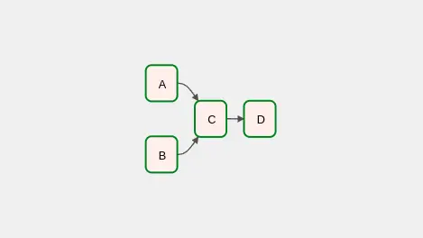
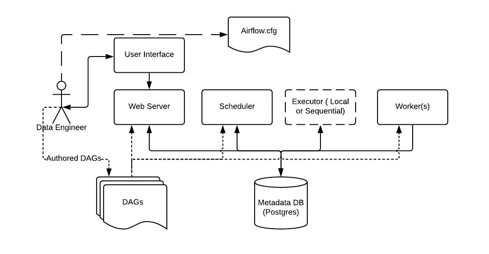
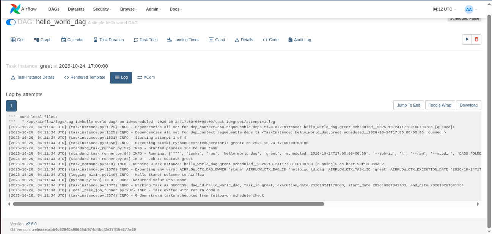

# Introduction to Apache Airflow

Link: https://supertype.ai/notes/intro-to-apache-airflow

Apache Airflow is an open-source platform built on Python to programmatically author, schedule, and monitor your pipelines.

## Installation & Setup

There are 2 ways of installing Airflow on your local machine: using Docker images (recommended way), or using PyPI to install Airflow in a virtual environment.

### Running Airflow in Docker

- Prerequisites: Docker and Docker Compose >= v2.27.0. Verify the Docker Compose version:

    ```bash
    docker compose version
    # Docker Compose version v2.36.2
    ```

- Download `docker-compose.yaml`

    ```bash
    curl -LfO 'https://airflow.apache.org/docs/apache-airflow/2.6.0/docker-compose.yaml'
    ```

- If you are running Linux OS, you will need to execute these following commands beforehand:

    ```bash
    mkdir ./dags ./logs ./plugins
    echo -e "AIRFLOW_UID=$(id -u)" > .env
    ```

- Run database migrations and create the first user account (with username `airflow` and password `airflow`)

    ```bash
    docker compose up airflow-init
    ```

-  Run Airflow by using `docker compose up`, then navigate to `localhost:8080` and login using the credentials.

## Airflow Core Concepts

In Airflow, pipelines are defined as **DAGs** (Directed Acrylic Graph). As the name suggests, DAGs are topologically-ordered graphs with no cycle within them. They consist of **tasks**, along with the **dependencies** that express how they should run. Consider this simple DAG:



This DAG has 4 tasks: A, B, C, and D. It also shows the dependencies between tasks, which show the order in which the tasks will be done. Task A and B are the upstreams of task C, and task D is the downstream of task C. Each task has a specific goal, and the method to achieve it is called the **operator**. Essentially, operators are the one that run commands. There are many types of operators in Airflow:
- `BashOperator`: executes bash commands
- `PythonOperator`: calls Python functions
- `EmailOperator`: sends an email
- etc

To further clarify what you need to do when using Airflow, the official documentation has provided the architecture of Airflow:



Airflow needs a data engineer to configure the Airflow setup via `airflow.cfg`: type of executor, database connection, etc. The data engineer is also responsible for creating and managing pipelines, which is stored in the DAGs folder, via the user interface of the web server. Along with the web server, the DAGs are also accessible to:
- Scheduler, which is responsible for the scheduled triggering of workflows and submitting tasks into the executor (executor runs everything inside the scheduler and it passes the task execution to workers)
- Workers, which are responsible for the task execution

The web server, scheduler, executor, and workers are connected to the metadata database, in which they store the state of the DAGs.

## The first DAG

Create a simple DAG that consists of 2 tasks: `get_name` that returns a name of your own choice, and `greet` that prints `"Hello {name}! Welcome to Airflow!"`.

There are two Python functions:

```python
def get_name():
    return 'Stane'

def greet(name):
    print(f'Hello {name}! Welcome to Airflow!')
```

Let's turn these functions into tasks in a DAG.

### Multiple Ways of Creating a DAG

Defining a DAG can be done in 3 ways, the first one is by using a context manager — creating a `with` statement and passing the tasks and dependencies within it

```python
from airflow import DAG
from airflow.operators.python import PythonOperator

# create the DAG
with DAG(
    ...
) as dag:

    # define the tasks
    get_name = PythonOperator(
        task_id='get_name',
        python_callable=get_name
    )
    
    greet = PythonOperator(
        task_id='greet',
        python_callable=greet
    )

    # task dependencies - greet runs after get_name
    get_name >> greet
```

The second method of defining a DAG is by using a standard constructor. We will need to create a DAG object and pass it as a parameter of the task objects. Remember to also define the task dependencies!

```python
from airflow import DAG
from airflow.operators.python import PythonOperator

# create the dag
my_dag = DAG(...)

# define the tasks and pass the dag as an argument
get_name = PythonOperator(
    task_id='get_name',
    python_callable=get_name,
    dag=my_dag
)

greet = PythonOperator(
    task_id='greet',
    python_callable=greet,
    dag=my_dag
)

# task dependencies
get_name >> greet
```

The final method is by using the TaskFlow API. In this method, we can create a DAG by creating a function and adding `@dag` decorator onto it. Then we add `@task` decorator into our task functions we defined earlier (`get_name` and `greet`) and put them inside the dag function.

```python
from airflow.decorators import dag, task

@dag(...)
def taskflow_api_dag():
    
    @task()
    def get_name():
        return 'Stane'

    @task()
    def greet(name):
        print(f'Hello {name}! Welcome to Airflow')

    name = get_name()
    greet(name)

my_dag = taskflow_api_dag()
```

The TaskFlow API method produces the most concise code. Furthermore:
1. It is very similar with how we write and run Python functions
2. Easier to implement communication between tasks (XComs)

### Creating and Running the DAG

To create a DAG, simply create a `.py` file in the `dags` folder. Everytime you create a DAG, the first thing you want to do is to create some default arguments. This is a dictionary objects that contains the reusable arguments of operators in a DAG, e.g. the owner, number of retries attempts, retry delay, etc. So, instead of specifying this configuration to every operator within a DAG, we can create them beforehand and pass it into a DAG when we create it.

```python
from datetime import timedelta

default_args = {
    'owner' : 'stane',
    'retries' : 3,
    'retry_delay' : timedelta(minutes=1)
}
```

There are also some essential arguments that need to be passed when creating a DAG along with the default arguments:
- `dag_id`: the name of the DAG
- `start_date`: DAG starting date
- `schedule_interval`: the interval in which the DAG will run
- `catchup`: whether you want to rerun the DAG in the past

"What does it mean by rerunning the DAG in the past?" Suppose that you are creating a DAG that runs on a daily interval with a start date of 1 week prior. When you deploy this DAG, it will immediately schedule 7 runs all at once to catchup on the schedules that were missed. While this might be a very useful feature, you need to take precaution as to not overload your scheduler or external systems.

Simply pass in these arguments into the `@dag` operator. You need to pass `datetime` object into the `start_date` argument, and cron expression into the `schedule_interval` argument.

```python
from airflow.decorators import dag, task
from airflow.operators.python import PythonOperator
from datetime import datetime, timedelta, timezone

default_args = {
    'owner' : 'stane',
    'retries' : 3,
    'retry_delay' : timedelta(minutes=1)
}

@dag(
    description='A simple hello world DAG',
    start_date=datetime(2022, 8, 28, tzinfo=timezone(timedelta(hours=7))),
    schedule_interval='0 0 * * *',
    default_args=default_args,
    catchup=False
)
def hello_world_dag():

    @task()
    def get_name():
        'A function to get name'
        return 'Stane'

    @task()
    def greet(name):
        print(f'Hello {name}! Welcome to Airflow')

    name = get_name()
    greet(name)

my_dag = hello_world_dag()
```

Upon navigating to `localhost:8080` and refreshing the page, you should see your DAG being listed in Airflow. If you do not specify `dag_id` in the `@dag` decorator, the function name will be used.

If you click on the DAG name, you will see various tab views that you can use to see the details of the DAG, including the source code! The most important tab might be the graph view, where you can see the task logs. Try unpausing your dag by clicking on the switch button, then trigger the DAG run by clicking on the play button!

To see the logs, click on any task and choose the `Log` tab.



Notice that our DAG printed "Hello Stane! Welcome to Airflow" in the logs, indicating that it behaves as expected — the `get_name` function returns a name, which was used as a parameter of the `greet` function.

### XComs

By default, tasks are entirely isolated and might be running on different machines. Quite often in a real world scenario, we need to have these tasks communicate with each other.

In our previous DAG, for example, we need to use the returned value of the `get_name` task in the `greet` task. Under the hood, the returned name was automatically pushed into **XComs** — a mechanism that allows tasks to communicate with each other. Try clicking on the `get_name` task in the graph view and navigate to the XCom tab. It has an XCom key `return_value` with a value of `Stane`. This value is the one that was passed into the `greet` task.

Now, let's see what happens when we do not use the TaskFlow API to create our DAG. Create a new `.py` file and use the context manager or basic constructor method to recreate the Hello World DAG.

```python
from airflow import DAG
from airflow.operators.python import PythonOperator
from datetime import datetime, timedelta, timezone

default_args = {
    'owner' : 'stane',
    'retries' : 0
}

def get_name():
    return 'Stane'

def greet(name):
    print(f'Hello {name}! Welcome to Airflow!')

with DAG(
    dag_id='hello_world_context_manager_dag',
    description='Hello World DAG with context manager method',
    start_date=datetime(2022, 8, 28, tzinfo=timezone(timedelta(hours=7))),
    schedule_interval='0 0 * * *',
    default_args=default_args,
    catchup=False
) as dag:

    task_1 = PythonOperator(
        task_id='get_name',
        python_callable=get_name
    )

    task_2 = PythonOperator(
        task_id='greet',
        python_callable=greet
    )

    task_1 >> task_2
```

Try to unpause and trigger the DAG, then see what happens to the `greet` task in the graph view. It will show a failed status, with the following error in the logs

```
ERROR - Task failed with exception

TypeError: greet() missing 1 required positional argument: 'name'
```

The error happened because the `greet` task did not know that it should take the returned value of the `get_name` task. To fix this error, we need to tell the `greet` task that it needs to pull the name from the XComs. To do so, we need to utilize a default variable `ti`, which allows us to pull a value from XComs to a task. Fixing the `greet` function:

```python
def greet(ti):
    name = ti.xcom_pull(task_ids='get_name')
    print(f'Hello {name}! Welcome to Airflow!')
```

Now the DAG should run properly. However, the code becomes more complex. This shows yet another advantage of the TaskFlow API, in which you do not need to explicitly implement XComs.

Do take a note that despite its functionality, XCom is meant to be used only for relaying small messages. In fact, it has a maximum size of 48KB. The best practice for implementing communication between tasks is by **utilizing remote storage and database** — a task can store processed data in a remote storage (Amazon S3, Hadoop Distributed File System, Google Cloud Storage, etc) or a database and push the path into XCom, then the downstream tasks can pull the path from the XCom and use it to obtain the data.